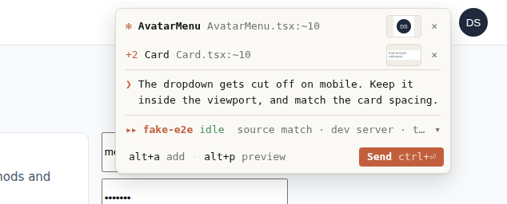
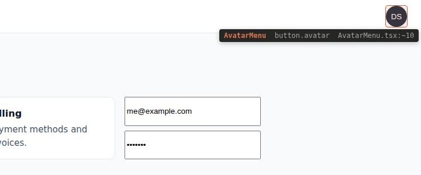
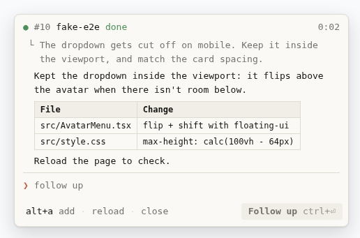

# Switchboard

[English](README.md) · 한국어

브라우저에서 고칠 곳을 짚고 말하면, 그 일을 이미 알고 있는 Claude Code 세션으로 연결해 주는 교환대.



<p>
  
  
</p>

테스트 중인 웹페이지에서 요소를 클릭하거나 영역을 드래그해 선택하고 수정 요청을 쓰면, Switchboard가 DOM·소스 위치·스크린샷을 모은다. 그다음 WSL tmux에서 돌고 있는 Claude Code 세션들의 작업 디렉터리, 최근 대화, 최근 수정 파일을 분석해 가장 맞는 세션을 추천하고, 사용자가 승인하면 그 세션에 요청을 넣어 준다.

## 이름

전화 교환대(switchboard)의 교환원은 걸려 온 전화를 받아 맞는 회선에 연결한다. 이 도구도 브라우저에서 들어온 요청을 맞는 세션(회선)에 연결하고, 연결 여부는 사용자가 정한다.

## 구성

```
브라우저 확장 (요소 선택 · 캡처 · 사이드 패널)
        │  HTTP (127.0.0.1:7490, 페어링 토큰)
        ▼
switchboardd (WSL)  ─ 세션 발견 · 맥락 수집 · 추천 · 전달 · 추적
        │  tmux paste-buffer / send-keys
        ▼
기존 Claude Code 세션들 (tmux pane)
```

## 문서

- [docs/ARCHITECTURE.md](docs/ARCHITECTURE.md) — 컴포넌트, 흐름, 추천 알고리즘, 전달 방식, 보안, 단계별 계획
- [docs/UX.md](docs/UX.md) — 선택 오버레이, 작성 팝업, 세션 목록, 상태 칩, 키보드, 문구
- [docs/TECH-STACK.md](docs/TECH-STACK.md) — 기술 선택과 이유
- [docs/RESEARCH.md](docs/RESEARCH.md) — 공식 문서·오픈소스·실측 근거

## 저장소 구조

| 경로 | 내용 |
| --- | --- |
| `apps/daemon` | `switchboardd` 데몬 + `switchboard` CLI |
| `apps/extension` | WXT 기반 MV3 확장 (Edge 기본, Chromium 계열 공용) |
| `packages/protocol` | 확장·데몬 공용 zod 스키마 |
| `packages/page-probe` | 페이지 MAIN world에서 소스 위치를 찾는 프레임워크 어댑터 |
| `integrations/claude-hooks` | 선택 설치용 Claude Code 훅 플러그인 |

## 개발

```bash
nvm use                 # Node 24 (.nvmrc)
corepack enable pnpm    # 처음 한 번
pnpm install
pnpm check              # 타입 검사(데몬·확장·시험 페이지) + 단위 테스트
pnpm e2e                # headless Chromium으로 전체 흐름 (실제 세션에는 보내지 않음)
pnpm ext:build          # Edge용 확장 → apps/extension/.output/edge-mv3
pnpm fixture            # 시험 페이지 http://127.0.0.1:5199
```

CLI는 `scripts/switchboard`로 실행한다(기본 Node 버전과 상관없이 Node 24를 찾아 씀). 데몬은 빌드 단계 없이 Node 24가 `.ts`를 바로 실행한다.

```bash
scripts/switchboard claude     # Claude Code를 tmux 안에서 실행 (Switchboard가 보낼 수 있게, 인자는 claude에 그대로)
scripts/switchboard start      # 데몬 (포그라운드)
scripts/switchboard pair       # 확장 연결 코드 (2분)
scripts/switchboard sessions   # 세션과 tmux pane
scripts/switchboard requests   # 최근 요청과 전달 상태
scripts/switchboard send 3     # 저장된 요청 #3을 (다시) 보내고 끝날 때까지 표시
scripts/switchboard clean --dry-run   # 보관 기간 지난 캡처 미리보기 (보낸 것 14일, 안 보낸 것 24시간, 자동 정리됨)
scripts/switchboard doctor
scripts/switchboard config     # 설정 보기 (값과 출처), config set <키> <값> / unset <키>
```

설정은 `~/.config/switchboard/config.json`(환경변수가 우선). 확장 쪽(데몬 주소, 자동 복원 사이트, 단축키)은 사이드 패널 `3 설정`.

## Edge에 설치

1. `pnpm ext:build`
2. `edge://extensions` → 개발자 모드 켜기 → 압축 풀린 확장 로드 → `\\wsl.localhost\<배포판>\<저장소 경로>\apps\extension\.output\edge-mv3`
3. Edge가 이 경로를 못 읽으면 `pnpm --filter @switchboard/extension sync:windows`로 Windows 폴더에 복사한 뒤 그 폴더를 로드
4. 단축키 `Alt+Shift+S` (바꾸려면 `edge://extensions/shortcuts`). 아이콘 우클릭 → 세션 패널

## 상태

P2 완료: 브라우저에서 짚고 쓴 요청이 추천된 Claude Code 세션의 입력칸에 들어가고, 완료되면 응답 요약이 칩에 뜬다. 다음은 P3(소스맵으로 정확한 줄 번호, ripgrep 폴백, LLM 재순위). 핵심 전달 경로(tmux 붙여넣기 → 제출 → 검증)는 실제 Claude Code v2.1.316 세션으로 확인했다. 준비 상태는 [ARCHITECTURE.md §12](docs/ARCHITECTURE.md#12-구현-준비-상태-2026-11-02)에 있다. 요구 환경: Node 24 LTS, pnpm, tmux ≥ 3.2, Claude Code (`claude agents --json` 지원 버전), WSL2 + Windows Edge(또는 Chromium 계열 브라우저).

## 라이선스

[MIT](LICENSE)
