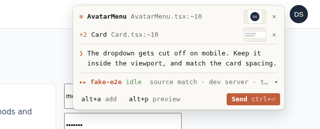
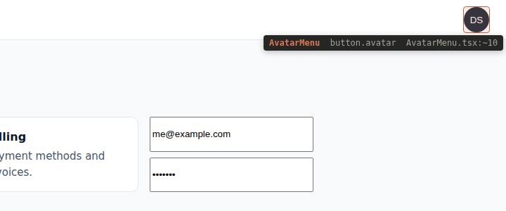
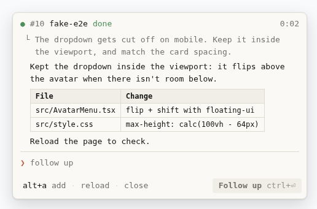
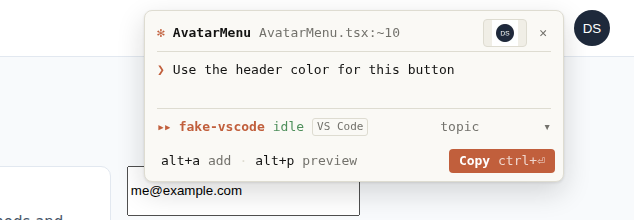
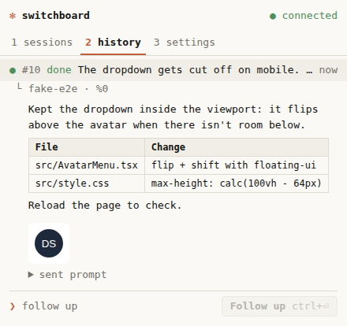
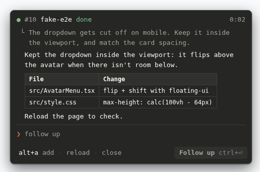

# Switchboard

English · [한국어](README.ko.md)

Point at something in your browser, say what to change, and Switchboard hands it to the Claude Code session that already knows that code.



1. In the page you're working on, press `Alt+Shift+S` and click an element (or drag a region).
2. Write the request. Switchboard collects the DOM, the source location (React, Vue, Svelte), and a screenshot.
3. It ranks your running Claude Code sessions (source file, dev server folder, recent edits, topic) and picks the best one.
4. You approve. The request lands in that session's input box, as if you typed it. A chip tracks it until Claude is done, and shows the full answer.

<p>
  
  
</p>

Nothing leaves your machine except what Claude Code itself sends. The daemon only listens on `127.0.0.1`.

> Status: early (0.1.0). Built and tested on Windows + WSL2 with Edge. Not affiliated with Anthropic.

## How it works

```
Browser extension (pick · capture · side panel)
        │  native messaging (browser starts the host) · or HTTP on 127.0.0.1:7490 with a paired token
        ▼
switchboard daemon ─ finds sessions · reads context · ranks · delivers · tracks
        │  tmux paste-buffer / send-keys     (VS Code: clipboard + focus the tab)
        ▼
Your existing Claude Code sessions
```

- Sessions come from `claude agents --json`, matched to tmux panes by process ancestry.
- Delivery pastes into the pane only when the input box is empty and no permission prompt is open, checks that the paste is visible before pressing Enter, and confirms the submit. It never retries Enter blindly.
- Completion is read from the session transcript (busy → idle); the chip shows Claude's final answer as Markdown.

## Which sessions work

| Session | Listed | Send |
| --- | --- | --- |
| Terminal, inside tmux | yes | yes, pasted like typing |
| Terminal, outside tmux | yes | view only. Start it with `switchboard claude` instead |
| VS Code extension | yes (`VS Code` tag) | copies the prompt and brings up that session's tab; you press `ctrl+v`, `enter`. Tracking and answers work the same |
| Background agents | yes | view only |
| Claude desktop app | no | no supported way in |



Plain terminals can't be typed into from outside (TIOCSTI is off on modern kernels, and Windows Terminal has no API for it). tmux can, which is why `switchboard claude` exists: it starts Claude Code inside a tmux session named after the folder and passes your arguments through.

## Requirements

- Linux or Windows with WSL2. macOS: implemented (`ps`, `lsof`) and being verified on a real Mac, see [docs/TESTING-MACOS.md](docs/TESTING-MACOS.md).
- Node.js 24+, pnpm (via corepack)
- tmux 3.2+
- Claude Code with `claude agents --json` (tested with 2.1.316)
- Edge or Chrome (Chromium MV3)

## Install

### From a release

1. Download `switchboard.mjs` and the extension zip (`switchboard-<version>-edge.zip` or `-chrome.zip`) from [Releases](https://github.com/DongInSong/switchboard/releases).
2. Unzip the extension and load it: `edge://extensions` (or `chrome://extensions`) → Developer mode → Load unpacked.
3. Let the browser start Switchboard itself (Node.js 24+):

```bash
node switchboard.mjs doctor                  # checks node, claude, tmux
node switchboard.mjs native install          # preview what gets registered
node switchboard.mjs native install --apply  # register the native messaging host
node switchboard.mjs claude                  # start Claude Code inside tmux
```

Reload the extension and you're done: the browser launches the host when the extension needs it, the host starts the daemon in the background, and there's no pairing. A daemon started this way exits after 30 idle minutes with nothing in flight (`daemon.idleExitMinutes`) and comes back on the next use. `node switchboard.mjs stop` stops it; `native uninstall --apply` removes the registration.

Without the native host, run `node switchboard.mjs start` and pair once with `node switchboard.mjs pair` (the side panel asks for the code).

### From source

```bash
git clone <this repo> && cd switchboard
corepack enable pnpm
pnpm install
pnpm ext:build                  # → apps/extension/.output/edge-mv3
scripts/switchboard doctor      # checks node, claude, tmux
scripts/switchboard start       # daemon (foreground)
```

Load the extension: `edge://extensions` (or `chrome://extensions`) → Developer mode → Load unpacked → `apps/extension/.output/edge-mv3`. From WSL, use the `\\wsl.localhost\<distro>\…` path, or `pnpm --filter @switchboard/extension sync:windows` to copy it to a Windows folder.

Pair once: run `scripts/switchboard pair` and type the 6-digit code into the side panel.

## Use

```bash
scripts/switchboard claude            # start Claude Code inside tmux (args go to claude)
```

- `Alt+Shift+S` pick · `Ctrl+Enter` send · `Esc` close · right-click cancels picking
- macOS: Option instead of Alt (`⌥⇧S` to pick, `opt+a` …), `⌘⏎` to send
- `alt+a` add another element to the same request, even from another page or tab (reference)
- `alt+l` attach this request to another open request
- `alt+p` preview the exact prompt
- Chips: click to expand the full answer, then write a follow-up (`alt+a` works there too)
- Popovers and chips survive reloads and SPA navigation

Side panel: `1 sessions` · `2 history` (full answers, follow-ups) · `3 settings` (daemon address, auto-restore sites, language, shortcut).

<p>
  
  
</p>

## Configure

```bash
scripts/switchboard config                    # every value and where it came from
scripts/switchboard config set port 7600
scripts/switchboard config set language ko    # CLI text and default prompt language
```

Precedence: environment variables > `~/.config/switchboard/config.json` > defaults. Invalid values stop the daemon with a reason instead of silently falling back. The extension's language follows the browser unless you pick one in settings; prompts are written in that language.

## Security

- With the native host, only this extension (fixed ID) can talk to it; the browser enforces that. Over HTTP, the daemon binds to `127.0.0.1` only, requires a paired bearer token, and rejects requests from web origins.
- Nothing is sent to a session without your approval. Text pasted into a terminal session runs with your authority, so be careful with sessions in bypass-permissions mode.
- Text collected from pages is marked as reference data, not instructions, in every prompt.
- The extension asks for host permissions only for sites you choose (auto-restore) and for a non-default daemon port.

## Limits

- React 19 line numbers are approximate (`:~12`); source maps are planned.
- macOS support is new and not yet verified on real hardware.
- Delivery reads Claude Code's input box from the tmux screen; a UI change in Claude Code may need an update here.
- Captures of sent requests are kept 14 days after the last activity, unsent ones 24 hours; cleanup is automatic (`switchboard clean --dry-run` to preview).

## Develop

```bash
pnpm check     # typecheck + unit tests
pnpm e2e       # headless Chromium end to end, with a fake Claude session on an isolated tmux server
pnpm fixture   # test page on http://127.0.0.1:5199
pnpm build:daemon   # dist/switchboard.mjs, the single-file daemon for releases
```

README images are taken by the same E2E run: `README_SHOTS=docs/images pnpm e2e`.

Design notes (Korean): [docs/ARCHITECTURE.md](docs/ARCHITECTURE.md), [docs/UX.md](docs/UX.md), [docs/TECH-STACK.md](docs/TECH-STACK.md), [docs/RESEARCH.md](docs/RESEARCH.md).

## License

[MIT](LICENSE)
